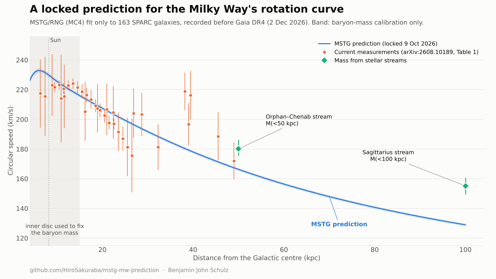

# MSTG/RNG: a locked prediction for the Milky Way's rotation curve

Benjamin John Schulz

## In plain language

Stars near the edge of the Milky Way orbit faster than the visible matter alone can explain. The usual explanation is an invisible halo of dark matter. MSTG is a different idea: gravity itself behaves slightly differently on the scale of galaxies, so that extra speed comes from the gravity of ordinary matter rather than from unseen mass.

A theory like that is only worth taking seriously if it can predict something before the data arrive. This repository is that prediction.

**How it was made.** The model was tuned once, on 163 other spiral galaxies from the SPARC catalogue, and its settings were then frozen. The only Milky Way input is how much ordinary matter (stars and gas) our galaxy contains. That was fixed using the inner part of the disc, within 15 kiloparsecs of the centre (about 49,000 light-years). Everything farther out is a genuine forecast.

**What it predicts.** The speed of stars orbiting the Galaxy should fall slowly with distance: about 207 km/s at 20 kpc (65,000 light-years), 192 km/s at 30 kpc, and 166 km/s at 50 kpc. That is a gentle decline. It is not the flat curve a standard dark matter halo gives, and not the steep fall-off you would see if there were no extra gravity at all.

**Why now.** The Gaia space telescope's next data release (DR4) is scheduled for 2 December 2026 and will measure these speeds far more precisely. This prediction was published on 9 October 2026, before that release.

**Where it could fail.** The forecast already looks too low far from the centre. Streams of stars torn from small satellite galaxies suggest the Milky Way holds more mass within 50 and 100 kpc than this model allows (the green diamonds in the plot). If Gaia DR4 shows the speed staying flat at about 215 km/s or more between 20 and 30 kpc, the model is wrong in its current form. A clear way to lose is the point of a real test.

## What is in this repository

- `mstg_mw_prediction_2026-10-09.zip`: the full locked package (model code, SPARC input data, fit outputs, prediction table, and SHA-256 checksums of every file).
- `ZIP_SHA256`: checksum of the zip.
- `mw_prediction_plot.png`: the plot above, drawn from the locked outputs.

The prediction was locked in commit `0b25f72` on 9 October 2026. The plain-language summary and the plot were added afterwards and change nothing in the prediction. An unmodified copy of the technical record below is `PREDICTION.md` inside the zip.

## Technical record (locked 9 October 2026)

Author: Benjamin John Schulz. Recorded 2026-10-09, before Gaia DR4 (scheduled 2026-12-02).

### What is locked
- Model: `mstg_sparc_pipeline_locked_v7.py`, branch MC4, unmodified.
- Global parameters from a single fit to SPARC (163 galaxies with Q <= 2, 3271 points; `fit_result_MC4.json`):
  r_IR = 6.394 kpc, log10 chi_acc = 2.000, comp_center = -2.500, log10 comp_sharp = -1.495,
  morph_scale_amp = -0.664, v_screen = 102.15 km/s, beta = 1.6e-3 (Method A negligible).
- No Milky Way-specific free parameter. The one external input is the Milky Way baryon model:
  Hernquist bulge (a = 0.7 kpc), Miyamoto-Nagai thin disc (3.0, 0.28) and thick disc (3.5, 0.9), gas disc (7.0, 0.1),
  with mass ratio 1.2 : 3.5 : 0.75 : 1.0 and R_d = 2.6 kpc. Overall mass scale calibrated on R <= 15 kpc only:
  M_bar = 7.71e10 Msun (1 sigma 7.58-7.84e10).

### Prediction (midplane circular speed, km/s)
| R (kpc) | 15 | 17.5 | 20 | 22.5 | 25 | 27.5 | 30 | 35 | 40 | 45 | 50 | 75 | 100 |
|---|---|---|---|---|---|---|---|---|---|---|---|---|---|
| v_c | 216 | 212 | 207 | 203 | 199 | 195 | 192 | 185 | 178 | 172 | 166 | 144 | 129 |

- Spherical-equivalent M(<50 kpc) = 3.2e11 Msun; M(<100 kpc) = 3.9e11 Msun.
- Power-law slope 20-50 kpc: gamma = -0.22. Asymptotic slope (75-200 kpc): -0.42 (approaching Keplerian).
- The quoted band (+/- 1-2 km/s) covers only the baryon-scale calibration. Baryon geometry, R_d and gas-profile systematics are not propagated and are probably several km/s.

### Falsification criteria
- Gaia DR4 disc tracers: MC4 fails if the 20-30 kpc curve is flat at >= 215 km/s, or falls below 185 km/s at 25 kpc.
- Outer halo: MC4 fails if M(<50) >= 3.6e11 or M(<100) >= 4.8e11 is confirmed.
  Against current constraints it is already 2.9 sigma low against Orphan-Chenab (3.77 +0.26/-0.19 e11) and 4.3 sigma low against Sagittarius (5.6 +/- 0.4 e11).

### Status against current data (arXiv:2608.10189, Table 1)
- Inner calibration: chi2 = 8.1 for 11 points (R <= 15 kpc).
- Predicted outer points (24 points, R > 15 kpc): chi2 = 30.5. Worst pulls are the halo-tracer points at 38-39 kpc (-3.0, -2.3).

### Caveats recorded at lock time
- chi_acc and comp_center are fixed at their v7 bounds. The composition gate is open for every SPARC galaxy (amp_outer = 5.31 universally). The prediction is therefore conditional on the v7 bounds.
- With amp_outer = 5.31 in the Milky Way, the rev19 PPN-a argument (amp_outer = 0 at chi_acc = 1.63) does not apply to the locked fit.
- MC4 gives the midplane v_c only. It makes no a_z(R, z) prediction.

### Reproduce
    python3 -I mstg_sparc_pipeline_locked_v7.py fit-sparc --rotmod-dir <unzipped Rotmod_LTG> --metadata SPARC_Lelli2016c.mrt --output-dir out --branches M0 MC4
    python3 -I mw_calib.py <dir with pipe/mstgv7.py, out_v7/, run/table1.txt>
Checksums of every input and output are in SHA256SUMS.
